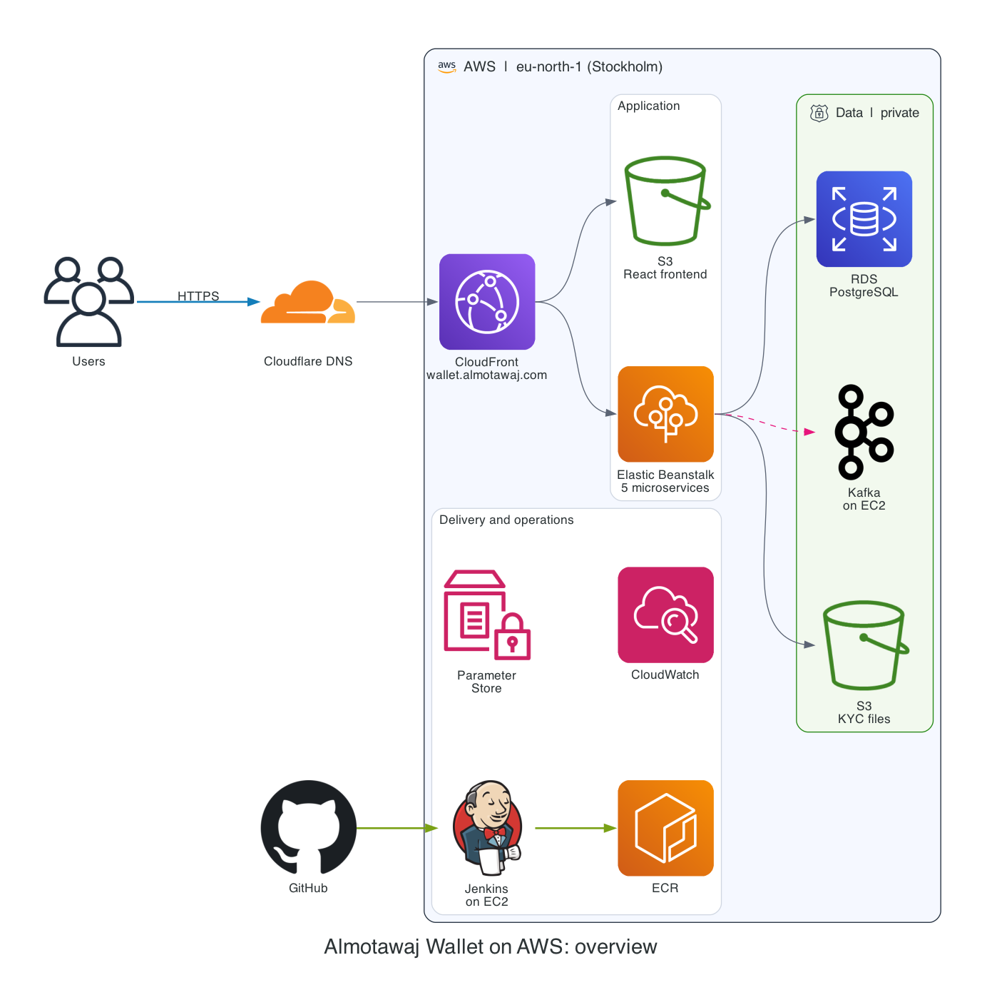

# Almotawaj Digital Wallet

A bilingual (English / Arabic) digital wallet for Bahrain.

- Clients register, verify their identity (KYC) and get a wallet with its own IBAN.
- They send, request and receive money, buy vouchers and pay merchants.
- Staff review identity documents and manage users.

Phase 04 runs the same app as **5 microservices** with **Kafka**, **Docker**, **Jenkins** and **AWS**.

## Links

- **App:** https://wallet.almotawaj.com
- **API:** https://wallet.almotawaj.com/api and `/auth`
- **Jenkins:** https://jenkins.almotawaj.com (login required)
- **pgAdmin:** https://pgadmin.almotawaj.com (login required)
- **Requirements checklist:** [`docs/phase-04/requirements.md`](docs/phase-04/requirements.md)
- **Planning:** [`docs/phase-04/planning.md`](docs/phase-04/planning.md)
- **Trello:** https://trello.com/b/81cjvTR6/project-02-jdb

## Architecture



1. Users open `wallet.almotawaj.com` (Cloudflare DNS → CloudFront).
2. CloudFront serves the React app from S3.
3. CloudFront sends `/api` and `/auth` to the API gateway on Elastic Beanstalk.
4. The gateway routes each request to its service.
5. Services store data in RDS and send events through Kafka.

More diagrams: [`docs/deployment/aws/18-architecture.md`](docs/deployment/aws/18-architecture.md)

## Services

| Service                | Port | Does                                        |
| ---------------------- | ---- | ------------------------------------------- |
| `api-gateway`          | 8080 | Routes requests, handles CORS               |
| `identity-service`     | 8081 | Accounts, login, KYC, permissions           |
| `wallet-service`       | 8084 | Wallets, transfers, vouchers, payouts, PDFs |
| `notification-service` | 8082 | Sends emails                                |
| `audit-service`        | 8083 | Saves the audit log                         |

- All services share one database; each writes only its own tables.
- Details: [`docs/phase-04/services.md`](docs/phase-04/services.md)

## Technologies

- **Backend:** Java 17, Spring Boot 4, Spring Security, Spring Cloud Gateway, Spring Kafka
- **Frontend:** React 19, TypeScript, Vite, Tailwind CSS, i18next
- **Data:** PostgreSQL, Apache Kafka, Amazon S3
- **DevOps:** Docker, Docker Compose, Jenkins
- **AWS:** Elastic Beanstalk, EC2, RDS, S3, CloudFront, ECR, IAM, Parameter Store, CloudWatch
- **Tests:** JUnit 5, Cucumber

## Kafka

| Topic            | From             | To           | Result            |
| ---------------- | ---------------- | ------------ | ----------------- |
| `account-events` | identity         | wallet       | Wallet created    |
| `email-events`   | identity         | notification | Email sent        |
| `audit-events`   | identity, wallet | audit        | Audit entry saved |

- Events are sent only after the database save succeeds.
- A failed message is retried 3 times, then moved to `<topic>-dlt`.
- Duplicate events are ignored.

## Run locally

1. Copy the settings file:

   ```bash
   cp .env.example .env
   ```

2. Start the 5 services, PostgreSQL and Kafka:

   ```bash
   docker compose up --build
   ```

3. Start the frontend:

   ```bash
   cd frontend && pnpm install && cp .env.example .env && pnpm dev
   ```

- API: http://localhost:8080
- App: http://localhost:5173

## CI/CD

Jenkins checks GitHub every 2 minutes and runs only what changed:

- **`services/` changed:** test → build images → push to ECR → deploy to Beanstalk
- **`frontend/` changed:** build → upload to S3 → refresh CloudFront
- **A test fails:** nothing is deployed

Setup: [`docs/deployment/jenkins.md`](docs/deployment/jenkins.md)

## AWS

- **Region:** `eu-north-1` (Stockholm)
- **Services:** Beanstalk runs the app; RDS holds data; Kafka and Jenkins run on EC2
- **Security:** database and Kafka are private; secrets live in Parameter Store; no access keys are stored

Step-by-step deployment guide: [`docs/deployment/aws/index.md`](docs/deployment/aws/index.md)

## Environment variables

Template: [`.env.example`](.env.example). On AWS, secrets come from Parameter Store. Never commit real values.

- **Secrets:** `DB_PASSWORD`, `JWT_SECRET`, `OTP_SECRET`, `INTERNAL_API_TOKEN`, `RESEND_API_KEY`, `SEED_TOKEN`, `SEED_PASSWORD`
- **Connections:** `DB_URL`, `DB_USERNAME`, `KAFKA_BOOTSTRAP_SERVERS`, `WALLET_URL`, `IDENTITY_URL`, `AUDIT_URL`
- **App:** `APP_URL`, `CORS_ALLOWED_ORIGINS`, `MAIL_FROM`, `STORAGE_BUCKET`

## Testing

- **167 tests:** identity 21, wallet 141, notification 3, audit 2
- **Cucumber:** send money, pay a payment request, bulk payout
- **Concurrency:** 20 buyers race for 1 voucher; exactly 1 wins, every time
- **On AWS:** register, email, KYC upload and login checked end to end

Run the tests of one service:

```bash
cd services/wallet-service && ./mvnw test
```

## Challenges

1. **Mac vs AWS chips:** images built on the Mac (arm64) failed on AWS (amd64). Fixed by building for amd64.
2. **Free AWS plan:** it blocked the instance size and the certificate region. Fixed by upgrading.
3. **Database password:** the stored password had a character RDS rejects. Fixed with a new safe password.
4. **Certificate blocked:** the domain did not allow Amazon certificates. Fixed with a CAA record.
5. **Logged out after login:** the frontend called a different address, so the cookie was dropped. Fixed by using one domain.

## Unsolved problems

- Kafka has no encryption or per-service permissions yet.
- All 5 services share one server.
- Live notifications work on one server only.

## Future improvements

- Secure Kafka (TLS, permissions, short email retention).
- One container service per microservice (ECS) behind a load balancer.
- CloudWatch alarms and dashboards.

## Documentation

- [`docs/phase-04/`](docs/phase-04/planning.md): planning, user stories, services, requirements
- [`docs/deployment/`](docs/deployment/aws/index.md): AWS steps, Jenkins, architecture diagrams
- [`docs/reference/`](docs/reference/api.md): API, roles and permissions, database schema
- [`docs/phase-02/`](docs/phase-02/planning.md), [`docs/phase-03/`](docs/phase-03/planning.md): earlier phases
- [`docs/project/credits.md`](docs/project/credits.md): credits and resources

## License

© 2026 Muntadher Almutawaj. All rights reserved. See [`LICENSE`](LICENSE).
