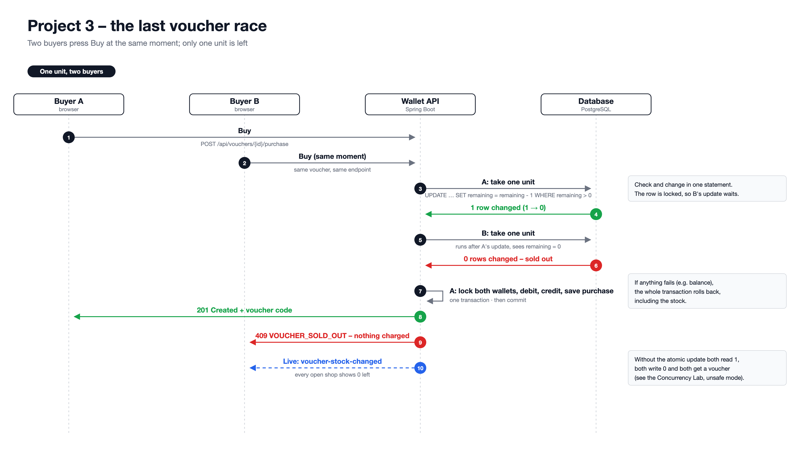

# Almotawaj Digital Wallet

A bilingual (English / Arabic) digital wallet for Bahrain. Clients register, verify their email and their identity (KYC), then get a wallet with its own IBAN to receive bank transfers and send money to other users and pay merchants; staff review identity documents and manage users through role- and permission-based access.

|             | URL                                                                                                                       |
| ----------- | ------------------------------------------------------------------------------------------------------------------------- |
| Web app     | https://wallet.almotawaj.com                                                                                              |
| API         | https://api.almotawaj.com                                                                                                 |
| Swagger UI  | https://api.almotawaj.com/swagger-ui.html                                                                                 |
| Sample shop | https://demo-shop.almotawaj.com – a merchant website that takes payments through the gateway                              |
| ERD         | [dbdiagram.io](https://dbdiagram.io/d/Digital-Wallet-6aba3c4e0f25a52d012826f8) · source: [`docs/erd.dbml`](docs/erd.dbml) |
| Planning    | P02: [`PLANNING-P02.md`](PLANNING-P02.md) · [`docs/USER-STORIES-P02.md`](docs/USER-STORIES-P02.md) · P03: [`PLANNING-P03.md`](PLANNING-P03.md) · [`docs/USER-STORIES-P03.md`](docs/USER-STORIES-P03.md)                               |
| Trello      | https://trello.com/b/81cjvTR6/project-02-jdb                                                                              |

Monorepo:

| Folder                | Stack                                                                                | Runs on               |
| --------------------- | ------------------------------------------------------------------------------------ | --------------------- |
| `backend/`            | Java 17, Spring Boot 4, Spring Security, Spring Data JPA, PostgreSQL                 | http://localhost:8080 |
| `frontend/`           | React 19, TypeScript, Vite, TanStack Query, React Hook Form, Zod, shadcn/ui, i18next | http://localhost:5173 |
| `examples/demo-shop/` | Node.js, TypeScript, no runtime dependencies                                         | http://localhost:4000 |

## Features

- **Accounts** – registration, login by email or mobile, email verification with 6-digit codes, forgot/reset password, change password. Changing or resetting a password signs out every other device.
- **Profile** – clients and merchants have a profile page with their details and a picture; merchants set a business name that customers see.
- **Identity verification (KYC)** – clients submit personal details, address, CPR and passport (PDF) and a photo; they can preview and download their own documents.
- **KYC review** – reviewers filter applications, preview documents and approve or reject with a reason. Clients are emailed the decision in English and Arabic.
- **User management** – search users, create users by invitation (they set their own password), edit contact details, suspend, reactivate and soft delete (close) accounts, and inspect a user's transactions.
- **Wallet** – a balance card with quick actions (send, receive, request) and recent activity; every verified client and merchant gets one wallet with a unique, generated Bahraini IBAN (`BH` + check digits + `ALMT` + 14 digits, valid ISO 13616 mod-97). Balances are in BHD with 3 decimals and every movement is an append-only ledger entry.
- **Receive transfers (simulated)** – choose one of five demo external accounts and an amount; the backend fills in the sender's name, IBAN and BIC.
- **Send money** – send to another wallet by email, mobile number or IBAN, with autocomplete (masked suggestions) and a masked recipient preview before sending.
- **Request money** – ask another wallet holder for money; they pay it with one tap or decline it, and the requester can cancel it while it is pending.
- **Merchant payments** – merchants create API keys and checkout sessions from their server or payment links from the dashboard; clients pay from their wallet on a hosted checkout page; merchants cancel pending payments and refund paid ones. An order can never be paid twice. A built-in developer guide explains the integration with request and response examples.
- **Transactions** – paged history with the counterparty, type, reference, signed amount and a details panel; search by name, reference or note and filter by type, direction and date range. Filters live in the URL, so a filtered view can be bookmarked.
- **PDF documents** – download a receipt for any transaction and a statement of the filtered history, generated by the API in English or Arabic.
- **Live notifications** – money received and payment requests arrive instantly over Server-Sent Events, with a toast and a sound.
- **Statistics** – staff with the `STATISTICS_VIEW` permission see the number of users per role, transaction totals for any filter and every wallet's transactions.
- **Permissions** – the super admin grants fine-grained permissions to admins with checkboxes.
- **Audit log** – every sign-in, account, administrative and money action is stored and listed for the super admin, in English and Arabic.
- **Security** – BCrypt passwords, httpOnly `SameSite=Strict` JWT cookie, token revocation, HMAC-hashed one-time codes, rate limiting, strict CORS, CSP/HSTS and other security headers on both apps, file type checks by content, row locks on every money movement.
- **Vouchers (Project 3)** – merchants sell a limited number of discounted vouchers; clients buy them with their balance, get a unique code and spend it when paying that merchant's checkout (for example in the sample shop). The last unit always goes to exactly one buyer, and a code can only be used once.
- **Bulk payouts (Project 3)** – merchants pay many people in one request; a thread pool pays them in parallel in the background with live progress, and the balance never goes negative.
- **Concurrency Lab (Project 3)** – the super admin runs real races in a throw-away sandbox and sees every thread on a timeline, safe versus unsafe.
- **Localisation** – the whole UI and every email are available in English and Arabic (RTL).

## Documentation

| Document                                             | What it covers                                                                                                 |
| ---------------------------------------------------- | -------------------------------------------------------------------------------------------------------------- |
| [`backend/README.md`](backend/README.md)             | Backend setup, profiles, seeding, structure, tests and JavaDoc                                                 |
| [`frontend/README.md`](frontend/README.md)           | Frontend setup, scripts, structure, pages and localisation                                                     |
| [`docs/api.md`](docs/api.md)                         | Endpoint reference, error format, paging, rate limiting, payment gateway, PDF documents and live notifications |
| [`docs/business-rules.md`](docs/business-rules.md)   | Roles, permissions and business rules                                                                          |
| [`docs/deployment.md`](docs/deployment.md)           | Cloud Run and Vercel deployment with every environment variable                                                |
| [`examples/demo-shop`](examples/demo-shop/README.md) | A sample store that integrates the payment gateway, for trying every payment outcome                           |
| [`docs/USER-STORIES-P02.md`](docs/USER-STORIES-P02.md)       | User stories with acceptance criteria                                                                          |
| [`docs/USER-STORIES-P03.md`](docs/USER-STORIES-P03.md)       | Project 3 user stories                                                                                         |
| [`docs/erd.dbml`](docs/erd.dbml)                     | Database schema ([diagram](https://dbdiagram.io/d/Digital-Wallet-6aba3c4e0f25a52d012826f8))                    |
| [`PLANNING-P02.md`](PLANNING-P02.md)                         | Process, timeline, requirement coverage and next steps                                                         |
| [`PLANNING-P03.md`](PLANNING-P03.md)                         | Project 3 plan: tasks, concurrency fixes, endpoints and tests                                                  |
| [`CREDITS.md`](CREDITS.md)                           | Credits and external resources for Projects 2 and 3                                                            |

JavaDoc is used on the main services: [`UserService.java`](backend/src/main/java/com/almotawaj/wallet/auth/service/UserService.java) (authentication), [`WalletService.java`](backend/src/main/java/com/almotawaj/wallet/wallet/service/WalletService.java) (wallet) and [`TransferService.java`](backend/src/main/java/com/almotawaj/wallet/wallet/service/TransferService.java) (transactions).

## Project 3 Changes

Project 3 extends the same wallet so that it stays correct when many people act on the same money or stock at the same moment. The plan and progress are in [`PLANNING-P03.md`](PLANNING-P03.md) and the stories in [`docs/USER-STORIES-P03.md`](docs/USER-STORIES-P03.md).

| Area | What changed |
| --- | --- |
| New functionality | Merchant vouchers (create, edit, pause, sell), voucher purchases with codes, bulk payouts, idempotent purchases, bank-style PDF statements, vouchers used at checkout, voucher expiry, Concurrency Lab |
| New models | `Voucher`, `VoucherPurchase`, `PayoutBatch`, `PayoutItem`, `IdempotencyRecord` (16 entities in total, see the [ERD](docs/erd.dbml)) |
| Concurrency-sensitive workflow | Buying the last units of a voucher; paying many people from one merchant wallet at once |
| Race condition addressed | Two buyers both read "1 left" and both buy; parallel payouts each read the same balance and overdraw it; a payout counter loses increments |
| Concurrency techniques | Atomic conditional `UPDATE`, pessimistic row locks, optimistic locking (`@Version`), unique constraints, `ExecutorService`, `CompletableFuture`, `ReentrantLock` per voucher, `ConcurrentHashMap`, `AtomicInteger`, `CountDownLatch` |
| Database consistency | Every purchase and payout item is one transaction: stock, both wallets, the ledger and the purchase or item row commit together or not at all; a `CHECK (remaining >= 0)` constraint is the last line of defence |
| Asynchronous processing | Payout batches return `202` and run in the background (`@Async` on its own 4-thread pool, items on a 5-thread pool with `CompletableFuture`); live progress and stock changes go out over Server-Sent Events after commit |

### Diagrams

| Flow | Diagram |
| --- | --- |
| The last voucher race | [`docs/p03-voucher-race-flow.png`](docs/p03-voucher-race-flow.png) |
| Bulk payout on a thread pool | [`docs/p03-bulk-payout-flow.png`](docs/p03-bulk-payout-flow.png) |
| Charged once with an Idempotency-Key | [`docs/p03-idempotency-flow.png`](docs/p03-idempotency-flow.png) |
| Wallet deadlock and the smaller-ID-first fix | [`docs/p03-wallet-deadlock-flow.png`](docs/p03-wallet-deadlock-flow.png) |



### Concurrency Explanation

**Where concurrency happens.** Vouchers are a shared, limited resource: during a sale, many clients press Buy at the same moment, each request on its own server thread (and, on Cloud Run, possibly on different instances). Bulk payouts run 5 worker threads that all debit the same merchant wallet.

**What could go wrong without control.** With a plain read-then-write, every buyer reads `remaining = 1`, every buyer passes the check and every buyer writes `0`: one voucher is sold many times and many people are charged for something that does not exist. The Concurrency Lab shows this live: 20 buyers, 1 voucher, about 9 "winners". In payouts, threads that read the balance before others write it would overdraw the merchant, and `count = count + 1` done in Java loses increments.

**How it is prevented.**

| Problem | Solution |
| --- | --- |
| Overselling the last voucher | `UPDATE voucher SET remaining = remaining - 1 WHERE id = ? AND remaining > 0` – the database checks and changes the stock in one step; `0` rows changed means sold out (`409`) |
| Overdrawing a wallet | The buyer's and merchant's wallet rows are locked (`SELECT … FOR UPDATE`) in a fixed order, so they are never deadlocked and the balance check sees the latest value |
| Lost payout counters | `UPDATE payout_batches SET paid_count = paid_count + 1`, plus `AtomicInteger` for the live progress in memory |
| Stale voucher edits | `@Version`: an edit made from an old copy is rejected with `409` instead of overwriting |
| Double clicks and retries | `Idempotency-Key` with a unique `(user, key)` constraint: the second request gets the first purchase back |
| Buyers of the same voucher on one server | A `ReentrantLock` per voucher queues them before the database update |
| Using one voucher in two tabs | `UPDATE voucher_purchases SET status = 'REDEEMED' WHERE id = ? AND status = 'UNUSED'` in the payment transaction; `0` rows means already used (`422`) |

**Why this approach.** The database is the only thing all server instances share, so the protection lives there: Java locks only protect one JVM, so they sit in front of the database checks, never instead of them. The atomic update is the cheapest correct fix for a counter (no waiting on a read lock); row locks are used where a read must be followed by a dependent write (balances); optimistic locking fits edits, which rarely collide and should fail loudly rather than block.

### Testing

| Test | What it proves |
| --- | --- |
| `ConcurrencyIntegrationTest` – 20 threads buy 1 voucher, **repeated 50 times** | Exactly one `201`, 19 conflicts, stock 0, money adds up – every run |
| `ParallelPurchaseHttpTest` – 20 real parallel HTTP requests to `POST /api/vouchers/{id}/purchase` | One `201 Created`, nineteen `409 Conflict` |
| Same `Idempotency-Key` sent 10 times in parallel | One purchase, charged once |
| 10 payouts of 15 BHD from 100 BHD on 5 threads | 6 paid, 4 failed, 10 BHD left, never negative |
| Stale `version` on a voucher edit | `409`, the newer change survives |
| `VoucherRedemptionIntegrationTest` – one voucher used in 10 tabs at once, **repeated 20 times** | Exactly one payment succeeds, nine get `VOUCHER_NOT_USABLE`; refunds free the voucher |
| `SimulationServiceTest` | Safe mode never oversells; unsafe mode does, so the race is real |
| `VoucherAndPayoutControllerTest` | Status codes, roles, validation and Swagger for every new endpoint |

```text
Request A → 201 Created   {"code":"VCH-JKTQ-CAW8-SLW9", ...}
Request B → 409 Conflict  {"code":"VOUCHER_SOLD_OUT", "detail":"This voucher is sold out"}
```

Run them with `./mvnw test` in `backend/` (208 tests). To see it visually, sign in as the super admin and open **Concurrency Lab**.

### Updated API

| Method | Endpoint | Result |
| --- | --- | --- |
| `GET` | `/api/vouchers` | Vouchers on sale |
| `POST` | `/api/vouchers/{voucherId}/purchase` | `201`, `409 VOUCHER_SOLD_OUT`, `422`; optional `Idempotency-Key` |
| `GET` | `/api/vouchers/purchases` | My vouchers and codes |
| `GET` | `/api/checkout/{sessionId}/vouchers` | My vouchers usable for a checkout |
| `POST` | `/api/checkout/{sessionId}/pay` | Optional `{"voucherId"}`; `422 VOUCHER_NOT_USABLE` when already used |
| `GET` / `POST` | `/api/merchant/vouchers` | List / create my vouchers |
| `PUT` | `/api/merchant/vouchers/{voucherId}` | Edit with `version`; `409 VOUCHER_EDIT_CONFLICT` when stale |
| `GET` / `POST` | `/api/merchant/payouts` | List / start a bulk payout (`202`) |
| `GET` | `/api/merchant/payouts/{batchId}` | A batch with every item's result |
| `POST` | `/api/admin/simulations/voucher-race`, `/payout-race` | Sandbox races for the Concurrency Lab |

Full details, errors and live events: [`docs/api.md`](docs/api.md#vouchers-and-payouts-project-3) and [Swagger UI](https://api.almotawaj.com/swagger-ui.html).

### Challenges

- **Proving a race exists.** A correct implementation never fails, so the race had to be shown on purpose: the Concurrency Lab's unsafe mode reads, waits a few milliseconds and writes, which reliably oversells.
- **A stale cache hiding real results.** In the dev profile Spring keeps one persistence context open for the whole web request (open-session-in-view), so a summary re-read after the background threads finished still saw old balances and counts. Reading fresh values from the database fixed it.
- **Rate limits during a sale.** Writes were limited per IP address, so buyers behind the same network would block each other with `429`. Writes are now limited per signed-in user.
- **Database rules from Project 2.** PostgreSQL had check constraints listing only the old enum values, so new transaction types and audit actions were rejected until those constraints were dropped.
- **Testing threads.** Tests that use threads cannot roll back inside one transaction, so they create and clean up their own data, and the in-memory test database needed a longer lock timeout.

### Future Improvements

- Free coupons (price 0, "claim" instead of "buy").
- Idempotency keys on transfers and payouts too.
- Payout recipients from a CSV upload.
- A shared message broker for live events, so notifications reach users connected to any Cloud Run instance.

### Credits & External Resources

See [`CREDITS.md`](CREDITS.md#project-3-resources).

## Quick start

Prerequisites: Java 17+, PostgreSQL, Node.js 20+ and pnpm.

```bash
cd backend
createdb -U postgres digital-wallet
cp src/main/resources/application-dev.properties.example src/main/resources/application-dev.properties
./mvnw spring-boot:run
```

```bash
cd frontend
pnpm install
cp .env.example .env
pnpm dev
```

Fill in `application-dev.properties` before the first run; every key is explained in the [backend guide](backend/README.md#setup). Demo accounts for every role are created with one request, see [seeding](backend/README.md#seeding).

## Project management

Development follows feature branches (`feature-auth`, `feature-activity-audit`, `feature-admin-statistics`, …) with short Title Case commits. The process, timeline and remaining work are in [`PLANNING-P02.md`](PLANNING-P02.md); user stories with acceptance criteria are in [`docs/USER-STORIES-P02.md`](docs/USER-STORIES-P02.md); progress is tracked on [Trello](https://trello.com/b/81cjvTR6/project-02-jdb).

## License

© 2026 Muntadher Almutawaj. All rights reserved. See [`LICENSE`](LICENSE).
