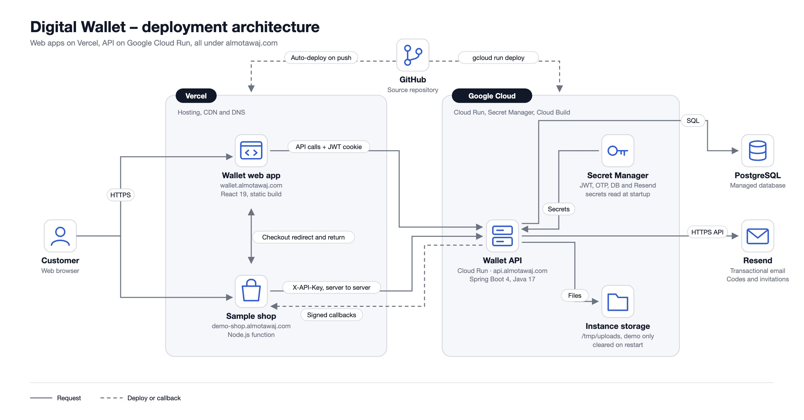

# Deployment

[← Back to the README](../README.md)



## Server Deployment – Google Cloud Run

The API runs on **Cloud Run** as service `wallet-api` in `me-central1`, on the custom domain `api.almotawaj.com`. Cloud Build packs `/backend` into a container, so there is no Dockerfile. `application-prod.properties` ships inside the build; Cloud Run only provides the values it reads: plain settings as environment variables, secrets from **Secret Manager**.

**1. Enable the services** (once per project):

```bash
gcloud services enable run.googleapis.com cloudbuild.googleapis.com artifactregistry.googleapis.com secretmanager.googleapis.com
```

**2. Create the secrets.** Paste the value, then press Ctrl+D:

```bash
gcloud secrets create DB_PASSWORD --data-file=-
gcloud secrets create RESEND_API_KEY --data-file=-
gcloud secrets create SEED_PASSWORD --data-file=-
```

Generated ones:

```bash
openssl rand -hex 32 | tr -d '\n' | gcloud secrets create JWT_SECRET --data-file=-
openssl rand -hex 32 | tr -d '\n' | gcloud secrets create OTP_SECRET --data-file=-
openssl rand -hex 24 | tr -d '\n' | gcloud secrets create SEED_TOKEN --data-file=-
```

**3. Let Cloud Run read them:**

```bash
gcloud projects add-iam-policy-binding <project-id> --member="serviceAccount:<project-number>-compute@developer.gserviceaccount.com" --role="roles/secretmanager.secretAccessor"
```

**4. Deploy** from the repository root:

```bash
gcloud run deploy wallet-api --source backend --region me-central1 --allow-unauthenticated --min-instances 1 --memory 1Gi \
  --set-env-vars "^;^SPRING_PROFILES_ACTIVE=prod;DB_URL=jdbc:postgresql://<host>:5432/<db>?sslmode=require;DB_USERNAME=<user>;CORS_ALLOWED_ORIGINS=https://wallet.almotawaj.com,https://www.wallet.almotawaj.com;APP_URL=https://wallet.almotawaj.com;MAIL_FROM=Almotawaj Wallet <no-reply@almotawaj.com>;STORAGE_ROOT=/tmp/uploads" \
  --set-secrets "DB_PASSWORD=DB_PASSWORD:latest,JWT_SECRET=JWT_SECRET:latest,OTP_SECRET=OTP_SECRET:latest,RESEND_API_KEY=RESEND_API_KEY:latest,SEED_TOKEN=SEED_TOKEN:latest,SEED_PASSWORD=SEED_PASSWORD:latest"
```

The `^;^` prefix makes `;` the separator, because `CORS_ALLOWED_ORIGINS` itself contains a comma. `--min-instances 1` keeps one instance warm so the demo never waits for Spring Boot to start; `--memory 1Gi` gives the JVM room.

**5. Map the domain:** in the Cloud Run console, add the custom domain `api.almotawaj.com` to `wallet-api` and create the DNS records it shows.

| Variable                       | Source         | Value                                                                                      |
| ------------------------------ | -------------- | ------------------------------------------------------------------------------------------ |
| `SPRING_PROFILES_ACTIVE`       | env var        | `prod`                                                                                     |
| `DB_URL`                       | env var        | `jdbc:postgresql://<host>:5432/<db>?sslmode=require` (any managed PostgreSQL)              |
| `DB_USERNAME`                  | env var        | database user                                                                              |
| `DB_PASSWORD`                  | Secret Manager | database password                                                                          |
| `JWT_SECRET` / `OTP_SECRET`    | Secret Manager | two different `openssl rand -hex 32` values                                                |
| `JWT_EXPIRATION_MS`            | env var        | optional, default `86400000` (24 h)                                                        |
| `CORS_ALLOWED_ORIGINS`         | env var        | `https://wallet.almotawaj.com,https://www.wallet.almotawaj.com`                            |
| `RESEND_API_KEY`               | Secret Manager | Resend key                                                                                 |
| `MAIL_FROM`                    | env var        | verified Resend sender                                                                     |
| `MAIL_LOGO_URL`                | env var        | optional logo URL for emails                                                               |
| `APP_URL`                      | env var        | `https://wallet.almotawaj.com` (email links)                                               |
| `STORAGE_ROOT`                 | env var        | `/tmp/uploads` (see below)                                                                 |
| `SEED_TOKEN` / `SEED_PASSWORD` | Secret Manager | optional, enables `POST /api/seed` (see the [backend guide](../backend/README.md#seeding)) |
| `WEBHOOK_ALLOW_PRIVATE_HOSTS`  | –              | leave unset in production; `true` only allows callbacks to local addresses in development  |

Cloud Run sets `PORT` itself. Its filesystem lives only as long as the instance, so uploaded KYC files and profile pictures in `/tmp/uploads` disappear on redeploy or restart; that is acceptable for the demo, and a Cloud Storage volume mount is the next step for lasting files.

**Updating:** change a setting with `gcloud run services update wallet-api --region me-central1 --update-env-vars KEY=value`. Rotate a secret with `gcloud secrets versions add NAME --data-file=-`, then deploy again so new instances read it.

## Web App – Vercel

Root directory `frontend`, ignored build step: _only build production_, domain `wallet.almotawaj.com`): set `VITE_API_URL=https://api.almotawaj.com`. `frontend/vercel.json` provides the SPA rewrite and security headers (CSP, HSTS, frame, referrer and permissions policies). API and web app share `almotawaj.com`, so the `SameSite=Strict` cookie works across them.

## Sample shop – Vercel

The [sample shop](../examples/demo-shop/README.md) is a second Vercel project from the same repository, on `demo-shop.almotawaj.com`. It is a merchant website of its own: its server calls `https://api.almotawaj.com` with an API key, and customers are redirected to `wallet.almotawaj.com` to pay.

1. On `wallet.almotawaj.com`, sign in as the merchant, create an API key on **API Keys**, set the callback URL to `https://demo-shop.almotawaj.com/webhooks/wallet` and copy the signing secret.
2. In Vercel, add a new project from this repository with root directory `examples/demo-shop` and framework preset **Other**. Leave the build and output settings empty: Vercel detects `src/server.ts` and runs it as a function.
3. Set the variables below, deploy, and add the domain `demo-shop.almotawaj.com`.

| Variable                | Value                             |
| ----------------------- | --------------------------------- |
| `WALLET_API_URL`        | `https://api.almotawaj.com`       |
| `WALLET_API_KEY`        | the API key from step 1           |
| `WALLET_SIGNING_SECRET` | the signing secret from step 1    |
| `SHOP_URL`              | `https://demo-shop.almotawaj.com` |

Nothing changes on the backend: the shop calls the API from its server, so it needs no CORS entry, and callbacks reach it because it has a public `https` address. Revoking the API key on the wallet turns the shop's payments off.
