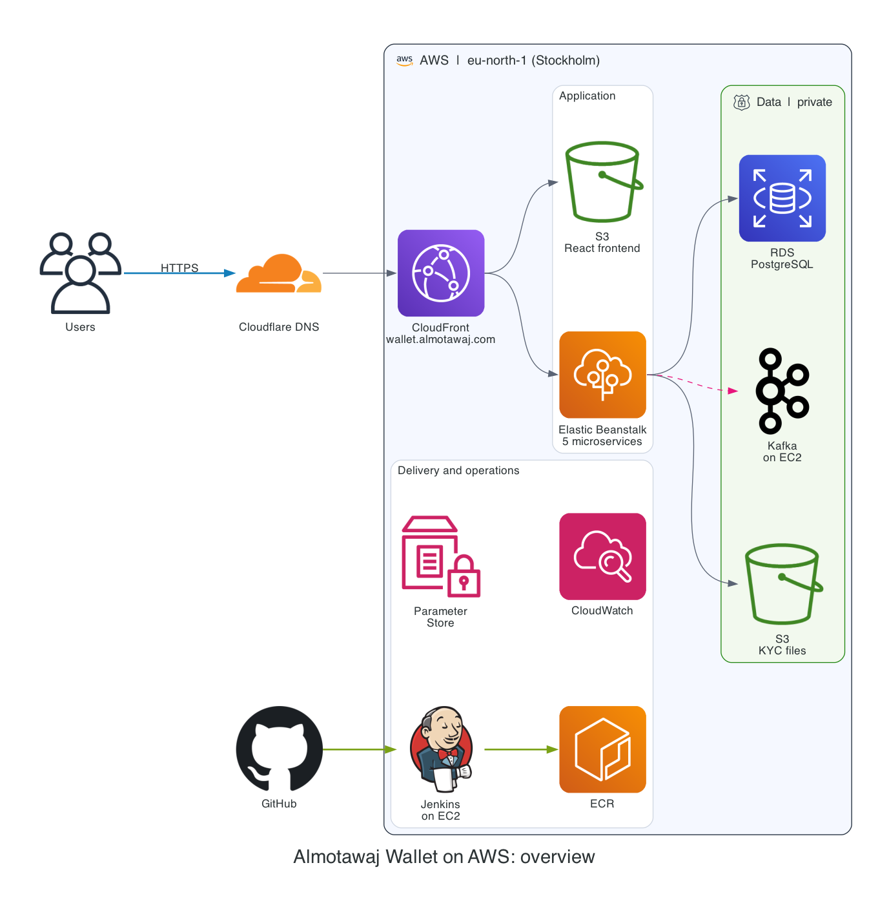
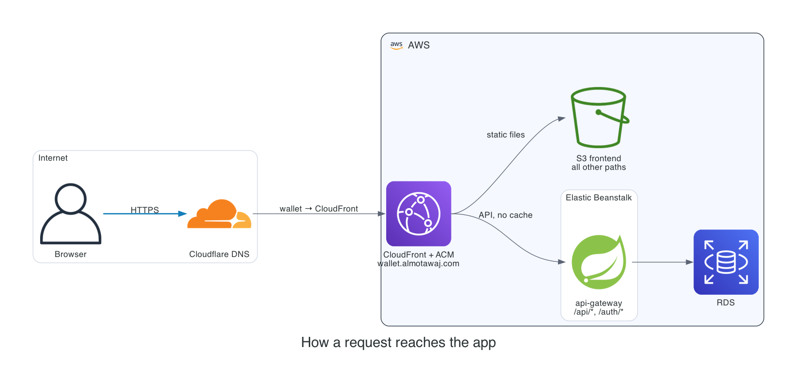
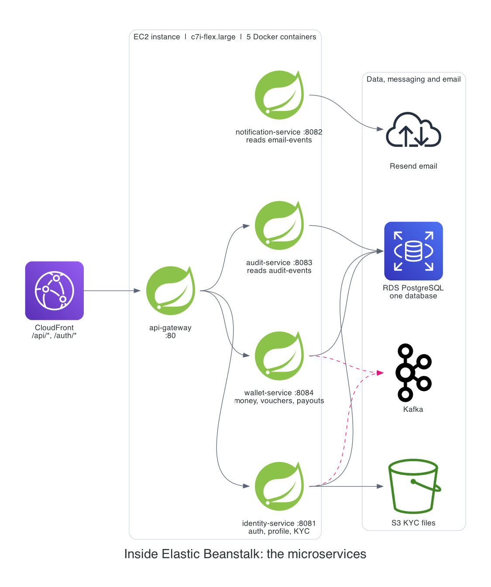
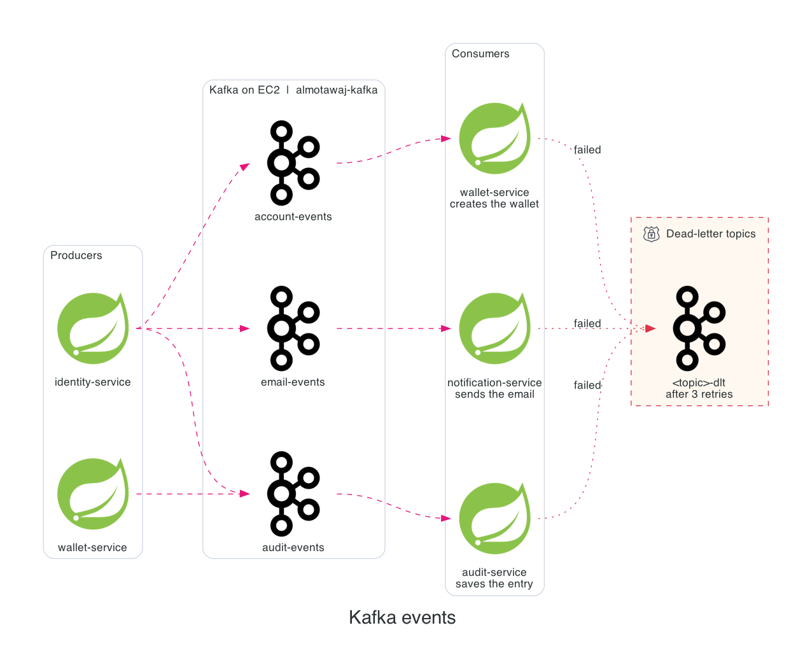
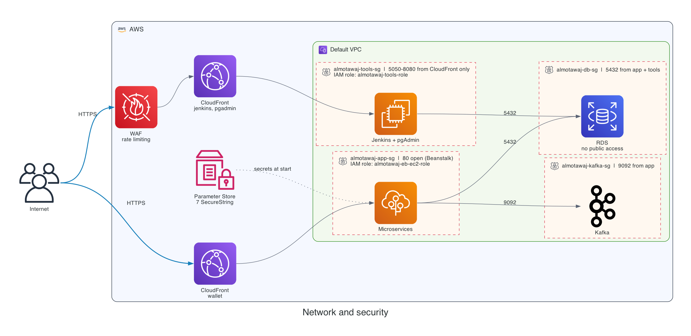
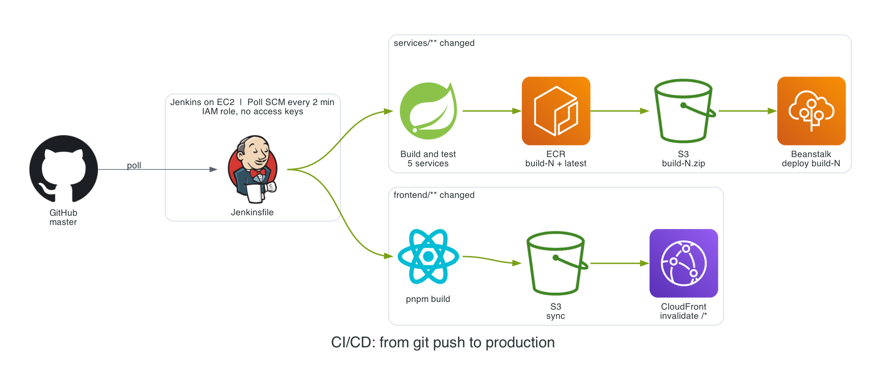
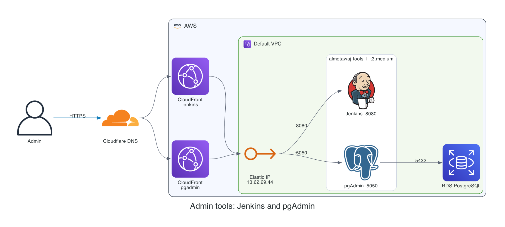
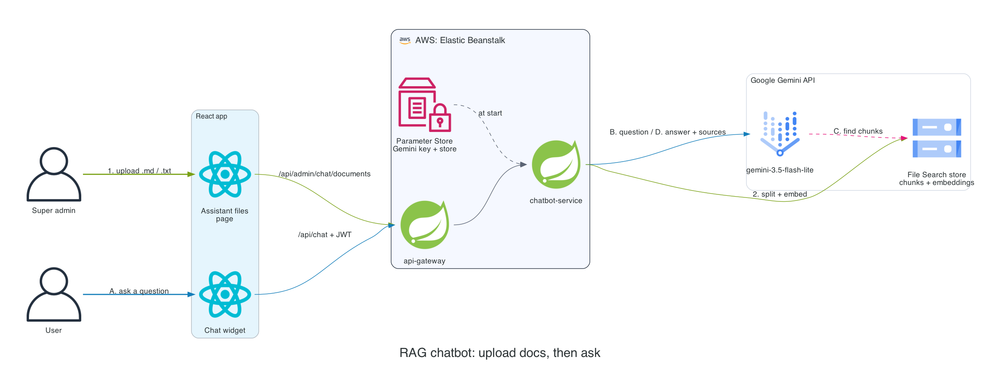

# Step 18: AWS Architecture

[← Back to AWS](index.md)

Eight diagrams: one overview, then one per question. All run in `eu-north-1` (Stockholm); only the CloudFront certificates live in `us-east-1`, as AWS requires.

## 1. Overview



Users reach `wallet.almotawaj.com` through Cloudflare DNS and CloudFront. CloudFront serves the React app from S3 and sends API calls to Elastic Beanstalk, where the six microservices run. Data stays private: RDS, Kafka and the KYC bucket. Jenkins builds from GitHub and publishes images to ECR; Parameter Store holds the secrets and CloudWatch the logs.

## 2. How a request reaches the app



One address serves both sides. CloudFront routes by path: static files go to S3, `/api/*` and `/auth/*` go to the gateway with caching off. Same address means the login cookie works and no CORS is needed between them.

## 3. Inside Elastic Beanstalk



One EC2 instance runs five Docker containers. The gateway routes each path to its service. Services share one PostgreSQL database, each writing only its own tables; identity and wallet also call each other over internal REST (protected by `X-Internal-Token`), and both publish events to Kafka.

## 4. Kafka events



| Topic | Producer | Consumer | Result |
| --- | --- | --- | --- |
| `account-events` | identity | wallet | Wallet created |
| `email-events` | identity | notification | Email sent through Resend |
| `audit-events` | identity, wallet | audit | Audit entry saved |

A message that fails 3 times (2 seconds apart) moves to `<topic>-dlt`. Duplicate events are ignored.

## 5. Network and security



| Resource | Who can reach it |
| --- | --- |
| Microservices | Anyone on port 80, through CloudFront for the domain |
| Jenkins, pgAdmin | CloudFront only (ports 5050-8080), WAF rate limiting in front |
| RDS | Microservices and tools only, port 5432; no public access |
| Kafka | Microservices only, port 9092 |

Secrets come from Parameter Store at start; each EC2 instance uses an IAM role, so no access keys are stored anywhere.

## 6. CI/CD



Jenkins on EC2 checks GitHub every 2 minutes and runs only the side that changed: the backend (test, image, ECR, Beanstalk) or the frontend (build, S3, CloudFront refresh). A failing test stops everything.

## 7. Admin tools



`jenkins.almotawaj.com` and `pgadmin.almotawaj.com` each have their own CloudFront and HTTPS, and both reach one EC2 instance through its Elastic IP. pgAdmin sits inside the VPC, so it is the only way in to the private database.

## Regenerate

The diagrams are code: [`docs/architecture/aws_architecture.py`](../../architecture/aws_architecture.py), using the [`diagrams`](https://diagrams.mingrammer.com) library with official AWS icons. It needs Graphviz:

```bash
brew install graphviz
python3 -m venv .venv && .venv/bin/pip install diagrams
.venv/bin/python docs/architecture/aws_architecture.py
```

Images are written to `docs/images/phase-04/architecture/`.

## 8. RAG chatbot



A super admin uploads docs; `chatbot-service` sends them to a Gemini File Search store, which splits and embeds them. When a user asks, the service sends the question to Gemini with the file search tool. Gemini finds the matching chunks and answers from them, returning the file names as sources. The API key and store name come from Parameter Store.
