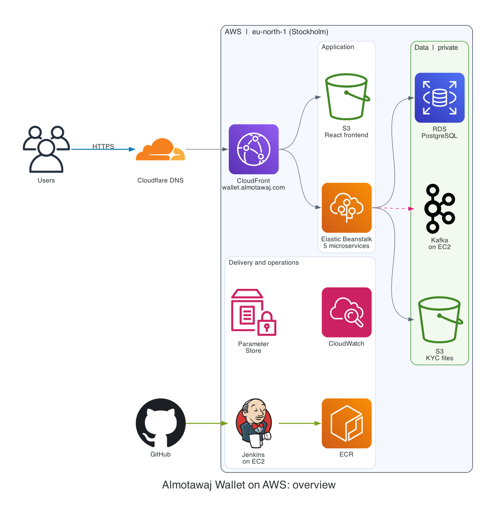

# AWS Deployment

[← Back to the README](../../../README.md)

Every AWS step is written down as it is configured. Follow the steps in order; each one links to its own page.

Budget: $100 credits. Delete everything after the presentation (see [Cleanup](#cleanup)).

## Architecture

Full diagrams: [Step 18](18-architecture.md).



```text
Internet
   |
Load Balancer (HTTPS)          public subnet
   |
Elastic Beanstalk: api-gateway, identity, wallet, notification, audit
   |                |
RDS PostgreSQL    Kafka on EC2  private subnet
```

## What runs where

Each EC2 instance runs its programs as Docker containers side by side.

| EC2 instance | Type | Runs |
| --- | --- | --- |
| `almotawaj-prod` (created and managed by Elastic Beanstalk) | `c7i-flex.large` | 5 microservices: identity, wallet, notification, audit, api-gateway |
| `almotawaj-kafka` | `t3.small` | Kafka |
| `almotawaj-tools` | `t3.medium` | Jenkins, pgAdmin |

The database runs on RDS (`almotawaj-db`), which AWS manages; it does not appear under EC2. The frontend is files in S3 served by CloudFront, with no server.

## Services used

| Need             | AWS service                                  |
|------------------|----------------------------------------------|
| Docker images    | ECR                                          |
| Run the services | Elastic Beanstalk (Docker), `c7i-flex.large` |
| Database         | RDS PostgreSQL                               |
| Kafka            | EC2                                          |
| Secrets          | Systems Manager Parameter Store              |
| Logs             | CloudWatch                                   |
| Access           | IAM, VPC, security groups                    |

## Steps

| #  | Step                                        | Page                                               | Status |
|----|---------------------------------------------|----------------------------------------------------|--------|
| 1  | Region, budget alert, IAM user              | [01-account-setup.md](01-account-setup.md)         | ✅     |
| 2  | VPC and security groups                     | [02-security-groups.md](02-security-groups.md)     | ✅     |
| 3  | ECR repositories                            | [03-ecr.md](03-ecr.md)                             | ✅     |
| 4  | Jenkins pushes images to ECR                | [04-jenkins-ecr.md](04-jenkins-ecr.md)             | ✅     |
| 5  | RDS PostgreSQL                              | [05-rds.md](05-rds.md)                             | ✅     |
| 6  | Kafka on EC2                                | [06-kafka-ec2.md](06-kafka-ec2.md)                 | ✅     |
| 7  | Secrets (Parameter Store)                   | [07-secrets.md](07-secrets.md)                     | ✅     |
| 8  | Elastic Beanstalk                           | [08-elastic-beanstalk.md](08-elastic-beanstalk.md) | ✅     |
| 9  | CloudWatch logs                             | [09-cloudwatch.md](09-cloudwatch.md)               | ✅     |
| 10 | Jenkins deploys automatically               | [10-jenkins-deploy.md](10-jenkins-deploy.md)       | ✅     |
| 11 | Verify end to end                           | [11-verify.md](11-verify.md)                       | ✅     |
| 12 | Frontend on S3 + CloudFront (HTTPS) | [12-frontend-cloudfront.md](12-frontend-cloudfront.md) | ✅ |
| 13 | Upgrade the AWS account to the Paid plan | [13-upgrade-account.md](13-upgrade-account.md) | ✅ |
| 14 | Custom domain `wallet.almotawaj.com`, CORS and `APP_URL` | [14-custom-domain.md](14-custom-domain.md) | ✅ |
| 15 | Jenkins deploys the frontend; frontend and backend separate | [15-jenkins-frontend.md](15-jenkins-frontend.md) | ✅ |
| 16 | KYC uploads to S3 | [16-kyc-s3.md](16-kyc-s3.md) | ✅ |
| 17 | Jenkins and pgAdmin on EC2 (HTTPS domains, private RDS) | [17-tools-ec2.md](17-tools-ec2.md) | ✅ |
| 18 | AWS architecture diagrams | [18-architecture.md](18-architecture.md) | ✅ |

## How each step page is written

- **Goal:** what this step gives us
- **Console clicks or commands:** exactly what was done, in order
- **Values chosen:** names, sizes, ports (never secrets)
- **Why:** one line per choice
- **Check:** how to confirm it works
- **Cost:** what it charges

## Cleanup

Filled in as resources are created, so nothing is forgotten.

| Resource | Name | How to delete |
|----------|------|---------------|
